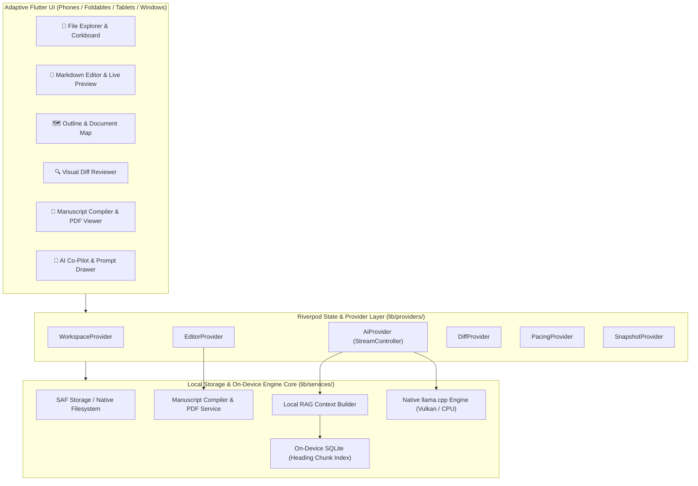

<div align="center">

# 🪶 Quill & Papyrus AI

### The Air-Gapped, On-Device AI Markdown IDE & Long-Form Writing Studio for Android & Desktop

**100% Offline • Native GGUF via `llama.cpp` • Vulkan GPU Acceleration • Local RAG • Zero Telemetry**

[](LICENSE)
[](https://android.com)
[](android/app/src/main/AndroidManifest.xml)
[](https://github.com/ggerganov/llama.cpp)
[](https://flutter.dev)

</div>

---

## 🌟 Why Quill & Papyrus AI?

Most modern "AI writing" apps are thin wrappers around cloud APIs: they require monthly subscriptions, log your keystrokes, and beam confidential notes, journals, and drafts to remote servers.

**Quill & Papyrus AI takes the opposite approach.** It is a dedicated, local-first Markdown IDE and long-form authoring studio engineered for on-device GGUF inference (optimized for Google **Gemma 4 E2B** and **Gemma 4 E4B**) executing **directly in your device's memory** using native C++ `llama.cpp` bindings and Vulkan GPU acceleration.

* 🚫 **No subscriptions or accounts:** Completely free and open-source.
* 🔒 **Zero network permissions:** The release [`AndroidManifest.xml`](android/app/src/main/AndroidManifest.xml) omits `android.permission.INTERNET`. The operating system physically forbids outbound network calls.
* ⚡ **Private Document Intelligence:** Your prose, notes, journals, and manuscripts never leave your silicon.

---

## 🚀 Key Features

* **⚡ Native GGUF Inference Engine (`lib/services/ai_service.dart`):** Direct native bindings to `llama.cpp` (`llama_flutter_android`) with Vulkan GPU offloading and multi-threaded CPU execution. Load any compatible 4-bit or 8-bit `.gguf` model file on your device, with an automatic deterministic offline fallback when no model is loaded.
* **🧠 Heading-Aware Local RAG (`lib/services/rag_service.dart`):** Automatically chunks workspace Markdown files by `# Headings`, extracts YAML frontmatter metadata, and indexes them in an on-device SQLite database (`sqflite` / `sqflite_common_ffi`) for context-aware Q&A and drafting.
* **📱 Adaptive Tri-Pane Layout (`lib/layout/`):** Responsive layout tailored for inner foldable screens (e.g., Samsung Galaxy Z Fold), Samsung DeX desktop mode, Windows desktop, and tablets:
  * **Left:** Workspace file explorer, frontmatter tag browser, and Corkboard overview.
  * **Center:** Multi-mode Markdown editor (Source, Live Split View, and Rich Preview), Document Map / outline, and Pacing Quota tracker.
  * **Right:** AI Co-pilot drawer with real-time token streaming, prompt templates, and Sidecar tools.
  * *Collapses automatically into a compact single-pane navigation flow (`SinglePaneNav`) on standard phone displays.*
* **🔍 Visual AI Diff Review (`lib/services/diff_service.dart`):** Compare AI-suggested completions, rewrites, and edits against existing buffer text with inline, color-coded diff gutters before choosing to Accept or Reject changes.
* **📚 Scrivenings, Snapshots & Long-Form Manuscript Compiler:**
  * **Scrivenings Mode (`lib/services/scrivenings_service.dart`):** Stitch multiple scenes or chapter files into one seamless editable buffer.
  * **Scene Snapshots (`lib/providers/snapshot_provider.dart`):** Save, compare, and rollback named versions of scenes without VCS overhead.
  * **Manuscript Compiler & PDF Engine (`lib/services/compiler_service.dart`, `pdf_service.dart`):** Combine folders or selected chapters into unified manuscripts with custom frontmatter stripping, chapter separators, title pages, and export or print directly via `pdf` and `printing`.
* **🎨 Atelier Themes & Bespoke Typography (`lib/theme/`):** Full dynamic theming (Atelier Sepia, Dark Obsidian, Parchment, Classic Ink) with 6 bundled variable and literary font families: Newsreader, Plus Jakarta Sans, JetBrains Mono, Courier Prime, Arimo, and Roboto.
* **🎙️ Multimodal Journal, Audio & Sketch Ingestion (`lib/services/ingest_service.dart`, `scripts/ingest.py`):**
  * Record voice memos directly into your notes via on-device audio recording and playback.
  * Ingest scans and photos using the document scanner and Windows camera dialogs.
  * Run the companion [`scripts/ingest.py`](scripts/ingest.py) pipeline with **Gemma 4 E2B** to detect and crop hand-drawn artwork bounding boxes (`[ymin, xmin, ymax, xmax]`) from Kindle Scribe or paper journal pages while transcribing handwritten notes into Markdown.
  * In-app PDF reading and side-by-side `SourceOcrCard` reference preview.
* **📁 Android Storage Access Framework (SAF) & Windows Filesystem:** Open and edit standard Markdown directories on device storage or SD cards without proprietary file silos or database lock-in.

---

## 🏗️ Architecture



---

## 💻 Tech Stack

| Layer | Technology | Purpose |
| :--- | :--- | :--- |
| **Language & Framework** | Dart `^3.12.2` / Flutter 3.x | Cross-platform UI (Android, Windows Desktop) |
| **State Management** | `flutter_riverpod` (`^2.6.1`) | Reactive state, tab management, and streaming controllers |
| **AI Inference** | `llama_flutter_android` (`^0.2.6`) / `llama.cpp` | On-device GGUF inference with Vulkan GPU acceleration & CPU multi-threading |
| **Persistence & Indexing** | `sqflite` (`^2.4.2`) / `sqflite_common_ffi` (`^2.4.4`) | Local heading index, metadata tags, chats, and RAG chunk store |
| **Markdown & Formatting** | `flutter_markdown`, `markdown`, `highlight`, `yaml` | Markdown parsing, live split preview, code highlighting, and YAML frontmatter |
| **Publishing & Documents**| `pdf` (`^3.13.1`), `printing` (`^5.15.1`) | Manuscript compiling, PDF rendering, and direct printing |
| **Media & Audio** | `record` (`^7.1.2`), `audioplayers` (`^6.8.1`), `image` (`^4.12.0`) | Voice note recording, audio playback, and document image pre-processing |
| **Testing** | `flutter_test`, `flutter_lints` (`^6.0.0`) | 24 unit, widget, and service integration test suites in `test/` |

---

## 🧠 Recommended Models & Hardware Matrix

Because the application is strictly air-gapped, you supply your own `.gguf` model weights. The prompt templates and context window limits are optimized for Google's **Gemma 4** mobile architectures:

| Model | Profile | Quantization | Size on Disk | Minimum RAM | Best Suited For |
| :--- | :--- | :--- | :--- | :--- | :--- |
| **Gemma 4 E2B** | Low-Power / High-Speed | `Q4_K_M` | ~1.5 GB | 4 GB | Fast drafting, proofreading, summaries, and battery-efficient mobile typing |
| **Gemma 4 E4B** | Primary / Deep Context | `Q4_K_M` | ~2.7 GB | 6 GB - 8 GB+ | Complex document synthesis, multi-turn RAG reasoning, and long-form outlining |

> 💡 **Performance Guidance:**
> * **Standard Smartphones:** **Gemma 4 E2B** provides rapid, fluid token streaming with low thermals and minimal battery drain.
> * **Foldables, Tablets & PCs:** (e.g., Galaxy Z Fold series with 12 GB RAM or Windows laptops) **Gemma 4 E4B** provides full-fidelity reasoning across large Markdown workspaces.
> * **Offline Fallback:** If no `.gguf` model file is loaded, a deterministic offline rule-based assistant provides basic outlining and templating.

---

## 📲 Setup & Model Sideloading

1. **Install the Application:**
   Download the latest release APK from [Releases](https://github.com/Herdingnomad/QuillPapyrusAI/releases) or build from source.
2. **Download a Model File:**
   Download a compatible `.gguf` model (such as Gemma 4 E2B / E4B in `Q4_K_M`) from Hugging Face on your device browser or transfer it via USB from your PC.
3. **Place or Select the Model:**
   Save the file to your device's model folder:
   ```text
   /storage/emulated/0/Documents/QuillPapyrus/models/
   ```
   *(Alternatively, tap **Model Selection** in the AI drawer to pick any `.gguf` file using the system file picker).*
4. **Open a Workspace Vault:**
   Select any local folder containing Markdown (`.md`) files. The application indexes headings for RAG and opens your workspace.

---

## 🛠️ Building & Running from Source

### Prerequisites
* [Flutter SDK](https://docs.flutter.dev/get-started/install) (`^3.12.2` / stable channel)
* [Android Studio & Android SDK](https://developer.android.com/studio) (API 34+) and Android NDK (for Vulkan `llama.cpp` Android builds)
* Java 17 (Temurin distribution recommended)
* Visual Studio with C++ Desktop Development tools (if building for Windows)

### Quickstart

```bash
# 1. Clone repository
git clone https://github.com/Herdingnomad/QuillPapyrusAI.git
cd QuillPapyrusAI

# 2. Fetch dependencies
flutter pub get

# 3. Analyze codebase
flutter analyze

# 4. Run tests
flutter test --no-pub

# 5. Launch locally (Android emulator/device or Windows desktop)
flutter run

# 6. Build optimized Android Release APK
flutter build apk --release
```

The output APK will be placed at:
```text
build/app/outputs/flutter-apk/app-release.apk
```

---

## 🧪 Testing & Quality Checks

Run the 24 automated test suites with Flutter:

```bash
# Static analysis and linting
flutter analyze

# Run all 24 unit, widget, and service test suites
flutter test --no-pub

# Run specific targeted service tests
flutter test test/compiler_and_pdf_test.dart
flutter test test/layout_test.dart
flutter test test/rag_service_test.dart
```

---

## 📂 Project Structure

```text
.
├── .agents/skills/             # Agent engineering skills (TDD, Spec Architect, SOLID, ADR, README)
├── android/                    # Android host project & permissions manifest
│   └── app/src/main/
│       ├── AndroidManifest.xml # Air-gapped manifest (0 internet permissions)
│       └── java/...            # QuickCapture, Widgets, and DeX integrations
├── assets/                     # App icons and 6 bundled variable/literary font families
│   ├── fonts/                  # Newsreader, PlusJakartaSans, JetBrainsMono, CourierPrime, Arimo, Roboto
│   └── icon/                   # App launcher icons
├── docs_local/                 # Feature architecture plans & comprehensive documentation
│   └── unified_journal_art_ingestion_plan.md
├── lib/
│   ├── app.dart                # MaterialApp shell and theme wrapper
│   ├── layout/                 # Adaptive shell (Tri-pane layout & single-pane navigation)
│   ├── main.dart               # Entrypoint, window setup, and database initialization
│   ├── models/                 # 17 domain entities (FileNode, EditorTab, AIConfig, Compiler, etc.)
│   ├── providers/              # 12 Riverpod state providers and controllers
│   ├── services/               # 25 core services (AI llama.cpp, RAG, SAF, Scrivenings, PDF, Diff)
│   ├── theme/                  # Atelier color schemes and typography definitions
│   └── widgets/                # UI components (AI panel, corkboard, dialogs, editor, preview, sidecar)
├── scripts/
│   └── ingest.py               # Python Gemma 4 E2B journal artwork cropper & handwriting OCR worker
├── test/                       # 24 unit, widget, and service integration test suites
├── windows/                    # Windows Desktop C++ runner and CMake configuration
├── AGENTS.md                   # Agent Operational Guidelines, Dynamic Skill Router & Command Map
├── design.md                   # System architecture and technical design specification
├── plan.md                     # Implementation roadmap and milestone tracking
├── pubspec.yaml                # Flutter dependencies and asset registrations
└── README.md                   # Project overview and documentation
```

---

## 📐 Specifications & Documentation

* [Agent Operational Guidelines & Skill Router](AGENTS.md)
* [Design & Architecture Specification](design.md)
* [Implementation Plan & Milestone Status](plan.md)
* [Unified Multi-Medium Journaling & Art Ingestion Plan](docs_local/unified_journal_art_ingestion_plan.md)
* [Contribution Guidelines](CONTRIBUTING.md)

---

## ❓ Frequently Asked Questions (FAQ)

<details>
<summary><b>Why doesn't the app download models automatically inside the UI?</b></summary>
Quill & Papyrus AI enforces an absolute air-gap guarantee: the release <code>AndroidManifest.xml</code> contains <b>zero network permissions</b>. Requesting network access for model downloads would compromise verifiable privacy. Sideloading models gives you complete transparency and ownership of your files.
</details>

<details>
<summary><b>Does on-device inference drain battery or overheat mobile hardware?</b></summary>
Inference only runs when you explicitly submit a prompt or request text transformations. The application immediately disposes of active inference threads when idle, preventing background power draw and thermal buildup.
</details>

<details>
<summary><b>Can I run Quill & Papyrus AI on desktop?</b></summary>
Yes. In addition to Android foldables, tablets, and phones (including Samsung DeX mode), the codebase supports Windows desktop via Flutter desktop embeddings and <code>sqflite_common_ffi</code>.
</details>

---

## 🤝 Contributing

Contributions, bug reports, and suggestions are welcome!

1. Check existing issues or open a new one on the [Issues page](https://github.com/Herdingnomad/QuillPapyrusAI/issues).
2. Review [`CONTRIBUTING.md`](CONTRIBUTING.md) for contribution guidelines, coding conventions, and pull request procedures.
3. Verify that all tests pass (`flutter analyze && flutter test`) before submitting a pull request.

---

## 📄 License

Distributed under the [MIT License](LICENSE). See [`LICENSE`](LICENSE) for full details.
