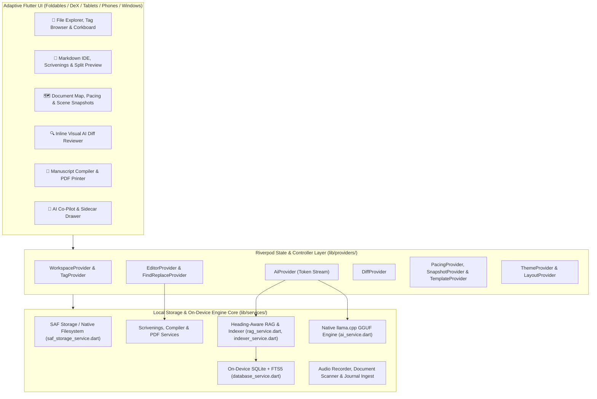

# Design & Architecture Specification: Quill & Papyrus AI

## 1. System Overview & Architecture

**Quill & Papyrus AI** is an air-gapped, on-device AI Markdown IDE and long-form manuscript authoring environment built with Flutter for **Android** (optimized for Samsung Galaxy Z Fold inner displays and Samsung DeX) and **Windows Desktop**.

The application pairs a distraction-free, Atelier-themed writing studio (supporting Scrivenings multi-scene stitching, Corkboard index cards, Scene Snapshots, Pacing Quotas, and PDF Manuscript Compilation) with locally executed Google **Gemma 4** models (**Gemma 4 E2B** and **Gemma 4 E4B** in `.gguf` format via `llama.cpp` / Vulkan GPU offloading) and heading-aware local SQLite RAG.

---

## 2. Technical Stack

| Layer | Component / Package | Role |
| :--- | :--- | :--- |
| **UI & Layout** | Flutter (`Dart ^3.12.2`) | Adaptive Tri-Pane (`ThreePaneLayout`) and Single-Pane (`SinglePaneNav`) shells |
| **State Management** | `flutter_riverpod` (`^2.6.1`) | 12 reactive state providers in `lib/providers/` |
| **On-Device AI Runtime** | `llama_flutter_android` (`^0.2.6`) | Native C++ `llama.cpp` bindings with Vulkan GPU offloading & offline fallback |
| **Database & RAG Index** | `sqflite` (`^2.4.2`), `sqflite_common_ffi` (`^2.4.4`) | Cross-platform SQLite persistence for chats, messages, snapshots, and heading chunks |
| **Markdown & AST** | `flutter_markdown`, `markdown`, `highlight`, `yaml` | CommonMark/GFM preview, syntax highlighting, YAML frontmatter, and `[[wikilink]]` resolution |
| **Publishing & PDF** | `pdf` (`^3.13.1`), `printing` (`^5.15.1`) | Multi-chapter manuscript compilation, themed PDF rendering, and direct print export |
| **Audio & Multimodal** | `record` (`^7.1.2`), `audioplayers` (`^6.8.1`), `image` (`^4.12.0`) | Voice memo dictation, inline audio cards, camera/scanner pre-processing, and OCR verify cards |
| **Typography** | 6 Bundled Font Families (`assets/fonts/`) | Newsreader, Plus Jakarta Sans, JetBrains Mono, Courier Prime, Arimo, Roboto |

---

## 3. Adaptive UI/UX & Long-Form Authoring Specs

### 3.1 Form-Factor Adaptive Shell (`lib/layout/adaptive_shell.dart`)
- **Unfolded Foldable / DeX / Tablet / Windows Desktop (`ThreePaneLayout`, width >= 840px):**
  - **Left Pane:** Workspace File Tree (`FileTreePanel`), YAML Frontmatter Tag Browser, and Corkboard view.
  - **Center Pane:** Multi-tab Markdown Editor (`EditorPane`) with Source, Live Split View, Rich Preview, Scrivenings stitched buffer, Document Map outline, and Pacing Quota progress bar.
  - **Right Pane:** Collapsible AI Co-Pilot Drawer (`AiPanel`) and Sidecar tools (`SidecarPane` for scene metadata, snapshots, and reference PDFs).
- **Folded Cover Display / Standard Phone (`SinglePaneNav`):**
  - Compact bottom-navigation shell switching cleanly between Explorer, Editor, and AI Co-Pilot with a mobile keyboard accessory toolbar (`MobileKeyboardAccessoryBar`).

### 3.2 Visual AI Diffs & Context Actions
- **Inline Diff Reviewer (`lib/services/diff_service.dart` & `lib/widgets/editor/inline_diff_widget.dart`):**
  - Computes line/block diffs between buffer text and AI proposals, rendering color-coded additions and deletions with interactive **Accept** / **Reject** controls.
- **Quick Selection Prompts:**
  - *Fix Grammar & Style*, *Expand / Deepen*, *Summarize to Bullets*, and *Convert to Action Items*.

### 3.3 Long-Form Literature & Manuscript Tools
- **Scrivenings Mode (`lib/services/scrivenings_service.dart`):** Temporarily stitches a folder of scene/chapter `.md` files into a single continuous buffer and splits changes back to their underlying files on save.
- **Scene Snapshots (`lib/providers/snapshot_provider.dart`):** Captures timestamped snapshots of individual documents for comparison and one-click rollback.
- **Corkboard & Scene Metadata (`lib/widgets/corkboard/` & `lib/models/manuscript_metadata.dart`):** Displays synopsis cards, POV, status badges, and word-count targets.
- **Manuscript Compiler & PDF Engine (`lib/services/compiler_service.dart` & `lib/services/pdf_service.dart`):** Compiles selected chapters into unified manuscripts with frontmatter stripping, custom scene separators, title pages, and direct PDF export.

---

## 4. Storage, Local RAG & Multimodal Ingestion

### 4.1 Air-Gapped Storage & SQLite Database (`quill_papyrus.db`)
- **Air-Gap Policy:** `android/app/src/main/AndroidManifest.xml` contains **zero** internet permissions. All workspace files remain in standard local folders accessed via Android SAF or native desktop directories.
- **Database Tables (`lib/services/database_service.dart`):**
  - `chats` & `messages`: Stores standalone and document-linked AI conversation histories.
  - `workspace_chunks` / FTS index: Stores Markdown sections chunked by `#`, `##`, `###` headings alongside `file_uri`, `parent_folder`, `heading_context`, `content`, and YAML `tags`.

### 4.2 Heading-Aware Directory-Scoped RAG (`lib/services/rag_service.dart`)
- Splits workspace `.md` files by heading hierarchy and indexes YAML frontmatter tags via `IndexerService`.
- Retrieves top relevant chunks scoped to the active workspace or folder and injects them into Gemma 4's prompt context window.

### 4.3 Multi-Medium Journal & Sketch Ingestion (`lib/services/ingest_service.dart` & `scripts/ingest.py`)
- Supports importing physical notebook scans, Kindle Scribe Colorsoft exports, and voice notes into `/Daily-Logs` (`MM-DD-YY.md`) and `/Assets/Sketches/`.
- Uses `Gemma 4 E2B` bounding-box detection (`[ymin, xmin, ymax, xmax]`) in `scripts/ingest.py` to crop hand-drawn illustrations while transcribing handwritten text into inline `SourceOcrCard` blocks.
